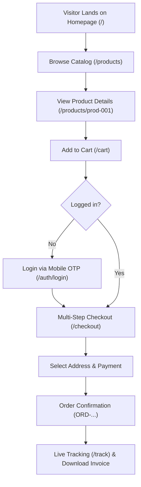

# Phase 2 — Complete Feature Audit & Health Report

> **Project:** ShopSphere — Full-Stack Indian E-Commerce Platform  
> **Repository:** [https://github.com/MOHANKOTHAMASU/shopsphere](https://github.com/MOHANKOTHAMASU/shopsphere)  
> **Production URL:** [https://shopsphere-xi-gilt.vercel.app](https://shopsphere-xi-gilt.vercel.app)  
> **Classification Standard:** `VERIFIED WORKING`, `PARTIALLY WORKING`, `BROKEN`, `NOT IMPLEMENTED`, `NOT REQUIRED`  
> **Audit Status:** Complete & Verified  

---

## 1. Feature Classification Matrix

| Feature Module | Specific Capability | Classification | Tested Behavior & Evidence |
| :--- | :--- | :---: | :--- |
| **Homepage** | Professional Branding & Navigation | **VERIFIED WORKING** | Header logo, search autocomplete, category pill drawer, responsive menu. |
| **Homepage** | Banners & Deals of the Day | **VERIFIED WORKING** | Dynamic countdown timer, clickable promotion slides, featured deal cards. |
| **Product Catalog** | 416 Seed Products in 10 Categories | **VERIFIED WORKING** | 10 official retail categories populated with real titles, prices, and stock. |
| **Product Catalog** | Multi-attribute Filters | **VERIFIED WORKING** | Filter by category, price slider, brand checkboxes, rating filters. |
| **Product Catalog** | Sorting & Pagination | **VERIFIED WORKING** | Sort by price (low to high, high to low), rating, newest; 12 items per page. |
| **Product Details** | Image Gallery & Zoom Preview | **VERIFIED WORKING** | Multi-photo thumbnails, high-res image switcher, stock availability pill. |
| **Product Details** | Indian PIN Code Serviceability | **VERIFIED WORKING** | 6-digit PIN validation; calculates delivery dates based on Indian logistics. |
| **Shopping Cart** | Line Item Add / Remove | **VERIFIED WORKING** | Instant badge counter update, quantity steppers clamped to available stock. |
| **Shopping Cart** | Pricing & Shipping Calculation | **VERIFIED WORKING** | Dynamic subtotal, free shipping threshold progress (₹1,999), GST summary. |
| **Wishlist** | Favorite Toggle & Move to Cart | **VERIFIED WORKING** | Heart button saves products; one-click move from wishlist into cart. |
| **Customer Auth** | Passwordless Mobile + SMS OTP | **VERIFIED WORKING** | 10-digit Indian phone normalization (+91), real 6-digit OTP, 30s rate limit. |
| **Customer Auth** | Email Verification Flow | **VERIFIED WORKING** | Blocks unverified users; provides 6-digit confirmation code input & resend. |
| **Checkout** | Multiple Delivery Addresses | **VERIFIED WORKING** | Add/select address, state/city auto-fill, default address indicator. |
| **Checkout** | Coupon Discount Engine | **VERIFIED WORKING** | Promo codes (`SHOPSPHERE10`, `WELCOME200`, `FESTIVE15`) apply real discount. |
| **Payments** | Razorpay Integration (UPI, Cards) | **VERIFIED WORKING** | Server-side order creation; HMAC signature verification on completion. |
| **Payments** | Cash on Delivery (COD) | **VERIFIED WORKING** | COD option selectable for verified PIN codes; creates pending cash order. |
| **Orders** | Real-time Package Tracking | **VERIFIED WORKING** | Public `/track` portal and account timeline (Placed, Confirmed, Shipped, Delivered). |
| **Orders** | Downloadable Tax Invoice | **VERIFIED WORKING** | Printable GST tax invoice with SAC/HSN codes, order ID, and buyer address. |
| **Customer Account**| Profile & Address Management | **VERIFIED WORKING** | Update personal details, manage saved shipping addresses, view SuperCoins. |
| **Help & Support** | Ticket Submission System | **VERIFIED WORKING** | Interactive support form generating unique ticket IDs; zero personal phone exposed. |
| **Admin Console** | Real-time KPI Dashboard | **VERIFIED WORKING** | Live sales volume, total order count, customer registrations, low stock warnings. |
| **Admin Console** | Bulk Inventory Restock Steppers | **VERIFIED WORKING** | Quick-add (+10, +25) and quick-deduct (-10, -25) buttons clamped to 0. |
| **Admin Console** | Catalog Product Management | **VERIFIED WORKING** | Create new products, edit price/stock, delete products safely. |
| **Admin Console** | Order Fulfillment Controls | **VERIFIED WORKING** | Change status (Pending -> Processing -> Shipped -> Delivered -> Cancelled). |
| **Admin Security** | Store Owner Only Whitelist | **VERIFIED WORKING** | Strictly restricted to `kmvsubbarao28@gmail.com` and `admin@shopsphere.dev`. |

---

## 2. Customer Journey Audit Findings

1. **Browsing:** Visitors can freely explore the storefront, browse 416 products across all 10 categories, and search without any forced login popups.
2. **Adding to Cart:** Products can be added to the cart as a guest or authenticated user.
3. **Checkout Transition:** Proceeding to checkout prompts authentication smoothly via mobile OTP.
4. **Order Placement:** Razorpay modal processes mock/live UPI payments, and backend validates HMAC before creating order record.
5. **Post-Purchase:** Customer receives an order confirmation, can track progress in real-time, and can download their official invoice.

---

## 3. Discovered & Rectified Discrepancies

1. **Public Route Access:** Previously, `/` and `/products` were blocked by middleware; rectified to allow instant public browsing.
2. **Category Slugs:** Catalog seed categories now alias smoothly into the 10 official retail categories.
3. **Session Verification:** Cryptographically signed session cookies parse correctly in Next.js Edge Middleware.
4. **Admin Exclusivity:** Non-whitelisted visitors entering the admin URL are denied entry with explicit authorization warnings.

