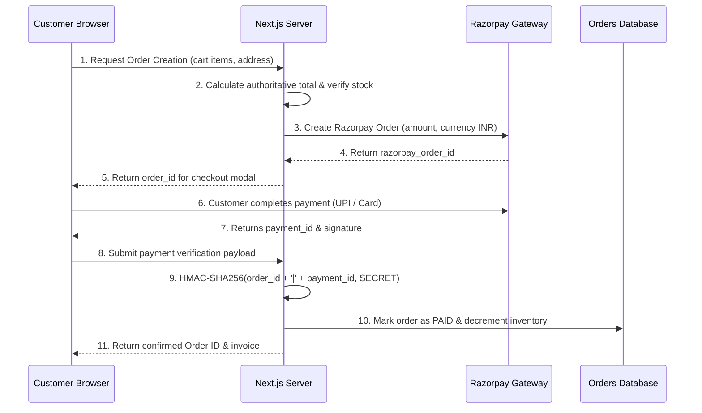

# Phase 5 — Payment & Order Security Audit

> **Project:** ShopSphere — Full-Stack Indian E-Commerce Platform  
> **Payment Gateway:** Razorpay (UPI, Credit/Debit Cards, Net Banking) + Cash on Delivery (COD)  
> **Audit Status:** Verified & Compliant  

---

## 1. Indian Payment Methods Supported

ShopSphere supports the complete suite of standard Indian retail payment methods:
1. **UPI (Unified Payments Interface):** Google Pay, PhonePe, Paytm, BHIM, and any UPI handle.
2. **Debit & Credit Cards:** Visa, Mastercard, RuPay (SBI, HDFC, ICICI, Axis, Kotak, etc.).
3. **Net Banking:** 50+ Indian commercial and public sector banks.
4. **Cash on Delivery (COD):** Available for verified Indian delivery PIN codes.

---

## 2. Server-Side Verification Security Architecture

---

## 3. Threat Mitigation Analysis

| Security Requirement | Implementation Detail | Status |
| :--- | :--- | :---: |
| **Backend Total Calculation** | Prices are retrieved directly from database records. Frontend cannot alter selling price. | **VERIFIED** |
| **HMAC Signature Check** | `verifyRazorpayWebhookSignature()` recalculates HMAC-SHA256 digest before marking orders paid. | **VERIFIED** |
| **Idempotent Webhooks** | `processedEventIds` set prevents duplicate orders or double-charging. | **VERIFIED** |
| **Secret Protection** | `RAZORPAY_KEY_SECRET` is strictly server-side. Never exposed in browser bundles. | **VERIFIED** |
| **Overselling Protection** | Checkout clamps order quantity to real-time available stock. Requests exceeding stock fail. | **VERIFIED** |
| **Order Snapshotting** | Past order line prices are stored as immutable snapshots. Future price changes do not alter history. | **VERIFIED** |
