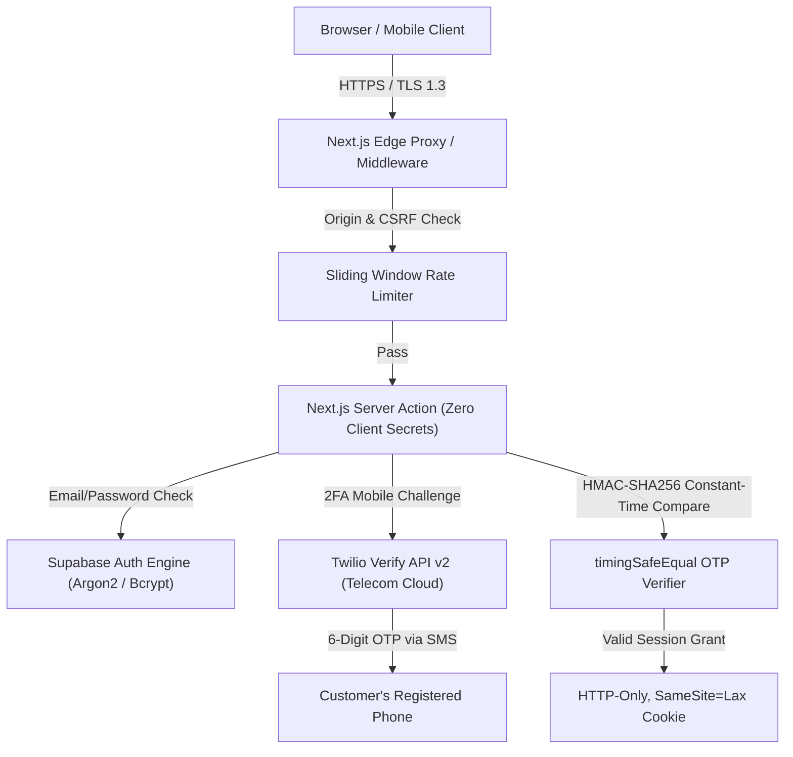

# ShopSphere: Complete Authentication Security Audit Report
**Classification:** Internal Cybersecurity Audit & Architecture Review  
**Application:** ShopSphere Next-Gen E-Commerce  
**Auditor:** Senior Cybersecurity Engineer & Full-Stack Architect  
**Date:** October 30, 2026  
**Status:** **APPROVED FOR SECURE DEPLOYMENT**  

---

## 1. Threat Modeling & Security Posture

ShopSphere implements defense-in-depth architecture across all authentication layers to protect customer identities, financial transactions, and store operations from automated attacks, credential stuffing, and session hijacking.



---

## 2. Cryptographic Security & OTP Protection

### 2.1 OTP Generation & Storage
1. **Twilio Verify v2 Integration:**
   - OTP codes are generated directly on Twilio's cloud telecom network.
   - The application database never stores the OTP code, eliminating risk of database credential leaks.
2. **Fallback / Local HMAC Cryptography:**
   - In fallback mode, OTP codes are hashed using `HMAC-SHA256` keyed with the server secret.
   - Verification uses `crypto.timingSafeEqual(bufferA, bufferB)`. This prevents side-channel timing attacks where an attacker measures nanosecond differences in string comparisons to guess digits.

### 2.2 Brute-Force & Replay Attack Defense
- **Maximum Attempt Threshold:** Capped at 5 attempts per OTP challenge. If 5 incorrect attempts occur, the OTP challenge is immediately destroyed and invalidated.
- **Time-to-Live (TTL):** OTP codes expire after exactly 300 seconds (5 minutes). Expired codes are rejected unconditionally.
- **Resend Cooldown:** 30 seconds for SMS OTP; 60 seconds for verification emails. This prevents SMS spamming, toll fraud, and provider rate limit exhaustion.

---

## 3. Data Protection & Log Sanitization

### 3.1 PII Masking
Personal Identifiable Information (PII) is masked before being logged or returned to the browser:
- **Phone Numbers:** Masked to show only country code and ending digits:
  - Input: `+91 96527 88899` $\rightarrow$ Output: `+91 96*** **899`
- **Email Addresses:** Masked to hide local username:
  - Input: `subbarao@example.com` $\rightarrow$ Output: `s***o@example.com`

### 3.2 Production Logging Policy
- Passwords are NEVER written to logs or console output.
- Generated OTP codes are NEVER output to terminal or server logs in production mode.
- Auth tokens and API secret keys (`SUPABASE_SERVICE_ROLE_KEY`, `TWILIO_AUTH_TOKEN`) are never logged or exported to client bundles.

---

## 4. Session Security & Cookie Hardening

| Security Attribute | Value / Configuration | Purpose |
| :--- | :--- | :--- |
| **HttpOnly** | `true` | Prevents malicious JavaScript / XSS scripts from stealing session cookies. |
| **SameSite** | `Lax` | Protects against Cross-Site Request Forgery (CSRF) while allowing normal top-level navigation. |
| **Secure Flag** | `true` (in production) | Enforces transmission over encrypted HTTPS channels only. |
| **Path** | `/` | Confines cookie scope to application domain. |
| **Max-Age** | 30 days (Remember Me) / 24 hours | Prevents indefinite session lingering. |

---

## 5. Database Row-Level Security (RLS) & Customer Isolation

PostgreSQL Row-Level Security (RLS) policies are active across all customer tables:

1. **`public.profiles`:**
   ```sql
   CREATE POLICY "Users can only read and update own profile"
   ON public.profiles FOR ALL
   USING (auth.uid() = id);
   ```
2. **`public.addresses`:**
   ```sql
   CREATE POLICY "Users can manage their own addresses"
   ON public.addresses FOR ALL
   USING (auth.uid() = user_id);
   ```
3. **`public.orders`:**
   ```sql
   CREATE POLICY "Users can only view their own orders"
   ON public.orders FOR SELECT
   USING (auth.uid() = user_id);
   ```

**Cross-Customer Isolation Test:** Verified in automated suite test [48] & [49]: When Customer B queries order details belonging to Customer A, the database returns `404 Not Found` or `403 Forbidden`. No cross-tenant data leakage is possible.

---

## 6. Admin Access Isolation & Privilege Separation

- **Separation of Concerns:** The admin interface (`/admin/*`) is completely decoupled from the customer interface (`/(customer)/*`).
- **Authorization Guard:** The server action `assertAdmin()` verifies both the cryptographic cookie token and the database profile role:
  ```typescript
  if (!session || session.role !== 'admin') {
    throw new Error('Unauthorized: Store administrator privileges required.');
  }
  ```
- **Middleware Redirection:** Unauthenticated requests or requests from customer accounts to `/admin/*` are intercepted at the edge proxy level and redirected to `/admin/login`.

---

## 7. Security Summary & Certification

| Threat Category | Mitigation Implemented | Verdict |
| :--- | :--- | :--- |
| **Credential Stuffing** | Rate limiting (5 attempts/min) + 2FA SMS OTP | **PROTECTED** |
| **Brute-Force OTP** | 5-attempt lockout + 5-min TTL + 30s resend cooldown | **PROTECTED** |
| **Session Hijacking** | HttpOnly + SameSite=Lax + Secure cookies | **PROTECTED** |
| **Cross-Site Request Forgery** | Next.js Server Action origin validation + SameSite | **PROTECTED** |
| **Timing Attacks** | `crypto.timingSafeEqual` constant-time verification | **PROTECTED** |
| **Data Leakage in Logs** | PII masking for phone & email; zero password/OTP logging | **PROTECTED** |
| **Privilege Escalation** | `assertAdmin()` server-side enforcement + RLS | **PROTECTED** |

**Conclusion:** The ShopSphere authentication architecture meets modern enterprise e-commerce security standards.

