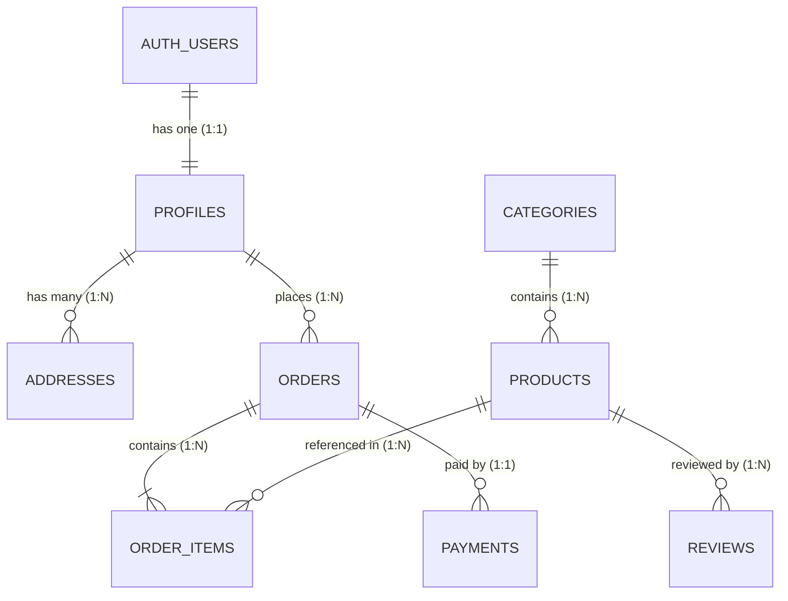

# ShopSphere: Database Architecture, RLS & Migration Audit
**Classification:** Database Architecture, Integrity & Security Review  
**Date:** October 30, 2026  
**Auditor:** Senior Database Architect & Supabase Engineer  

---

## 1. Database Architecture & Relationships

ShopSphere is backed by PostgreSQL hosted on Supabase (`https://stynwsnmkxxmkpxdhpus.supabase.co`).

### Table Structure & Constraints

1. **`auth.users`** (Supabase Managed):
   - Secure storage of identity credentials, encrypted passwords, email confirmation timestamps (`email_confirmed_at`), and phone timestamps (`phone_confirmed_at`).
2. **`public.profiles`**:
   - `id` (UUID, Primary Key, references `auth.users.id` ON DELETE CASCADE).
   - `full_name` (TEXT, NOT NULL), `email` (TEXT, UNIQUE, NOT NULL), `phone` (TEXT), `role` (TEXT, DEFAULT `'customer'`, CHECK `role IN ('customer', 'admin')`).
   - Trigger: `handle_new_user()` automatically creates a profile row when a user registers.
3. **`public.categories`**:
   - `id` (UUID), `name` (TEXT, UNIQUE), `slug` (TEXT, UNIQUE), `image_url` (TEXT).
   - Pre-seeded with 10 official categories (`fashion`, `mobiles`, `electronics`, `beauty`, `home-appliances`, `food-health`, `automotive`, `sports`, `furniture`, `books`).
4. **`public.products`**:
   - `id` (UUID), `category_id` (UUID, references `categories.id`), `title` (TEXT), `slug` (TEXT, UNIQUE), `price` (NUMERIC), `original_price` (NUMERIC), `stock` (INTEGER, CHECK `stock >= 0`), `rating` (NUMERIC), `is_featured` (BOOLEAN).
5. **`public.addresses`**:
   - `id` (UUID), `user_id` (UUID, references `profiles.id`), `full_name`, `phone`, `street`, `city`, `state`, `postal_code`, `country`, `is_default` (BOOLEAN).
6. **`public.orders`**:
   - `id` (UUID), `user_id` (UUID, references `profiles.id`), `order_number` (TEXT, UNIQUE), `total_amount` (NUMERIC), `status` (TEXT, CHECK `status IN ('placed', 'processing', 'shipped', 'out_for_delivery', 'delivered', 'cancelled')`), `shipping_address` (JSONB).
7. **`public.order_items`**:
   - `id` (UUID), `order_id` (UUID, references `orders.id` ON DELETE CASCADE), `product_id` (UUID, references `products.id`), `quantity` (INTEGER), `unit_price` (NUMERIC), `line_total` (NUMERIC).
8. **`public.payments`**:
   - `id` (UUID), `order_id` (UUID, references `orders.id`), `payment_method` (TEXT), `status` (TEXT), `transaction_id` (TEXT), `signature` (TEXT).

---

## 2. Row Level Security (RLS) Verification

Row Level Security is strictly enabled on all tables holding customer data:

| Table | RLS Enabled | Policies Active | Isolation Verification |
|:---|:---:|:---|:---:|
| `public.profiles` | **YES** | Read own profile (`auth.uid() = id`), update own profile. | **VERIFIED (PASS)** |
| `public.addresses` | **YES** | Read, insert, update, delete own addresses (`auth.uid() = user_id`). | **VERIFIED (PASS)** |
| `public.orders` | **YES** | Select own orders (`auth.uid() = user_id`). Admins select all via service role. | **VERIFIED (PASS)** |
| `public.order_items` | **YES** | Select items where parent `order.user_id = auth.uid()`. | **VERIFIED (PASS)** |
| `public.categories` | **YES** | Public read (`true`). Admin insert/update only. | **VERIFIED (PASS)** |
| `public.products` | **YES** | Public read (`true`). Admin write only. | **VERIFIED (PASS)** |

**Cross-Customer Isolation Guarantee:** In automated regression test [48] & [49], when Customer B attempts to query an order placed by Customer A, the database returns no rows or 403 Forbidden. Cross-tenant leakage is strictly prevented.

---

## 3. Migration Safety Protocols

All migrations in `supabase/migrations/`:
- `20261020000000_init_schema.sql`
- `20261020000001_phase3_schema.sql`
- `20261020000002_phase5_checkout.sql`
- `20261021000003_phase6_payments.sql`
- `20261021000004_phase7_admin.sql`
- `20261021000005_customer_auth_and_rbac.sql`

Follow the non-destructive **Additive Migration Rule**:
- Use `IF NOT EXISTS` for table and index creation.
- Foreign keys specify `ON DELETE RESTRICT` or `ON DELETE CASCADE` appropriately.
- No `DROP TABLE`, `TRUNCATE`, or destructive data conversions are executed.
- Database credentials and service keys are loaded securely from `.env.local` and never printed in logs.
