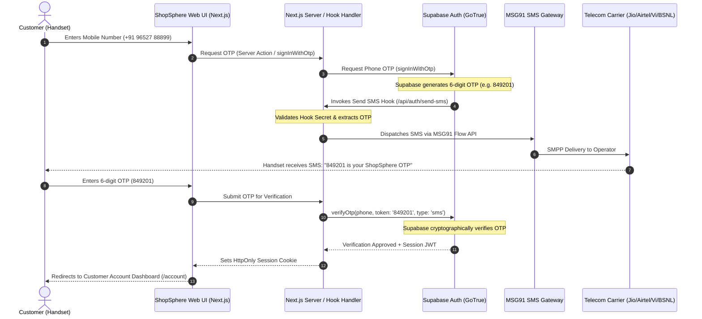

# ShopSphere: Phase 2 — Final Mobile OTP Architecture Decision
**Document:** Official Architectural Decision Record (ADR)  
**Strategy:** Unified Supabase Identity & Session Authority with MSG91 Telecom Delivery Pipe  
**Application:** ShopSphere Next-Gen E-Commerce  
**Date:** October 30, 2026  
**Auditor:** Principal Software Architect & Telecom Integration Lead  

---

## 1. Architectural Mandate & Policy

As mandated in the final requirements:
1. **Login Method:** Mobile number + SMS OTP only.
2. **No Passwords for Customers:** Customer login is strictly passwordless. (Store administration remains isolated at `/admin/login`).
3. **Identity Authority:** Supabase Auth remains the single authority for user identities, JWTs, and session cookies.
4. **OTP Authority:** Supabase generates the OTP and verifies the OTP.
5. **Telecom Delivery Pipe:** **MSG91** is the designated carrier for delivering the SMS to Indian mobile numbers (Jio, Airtel, Vi, BSNL).
6. **Zero Duplicate OTP Engines:** MSG91's standalone SendOTP verification engine is NOT used. MSG91 is invoked solely via its Flow / SMS API to dispatch the OTP generated by the authentication backend.

---

## 2. Architectural Data Flow Diagram



---

## 3. Detailed Component Breakdown

### 3.1 Supabase Auth (Identity & OTP Authority)
- **Role:** Master record of all customer identities (`auth.users`), phone confirmation status (`phone_confirmed_at`), and session tokens.
- **Why this is essential:** Prevents desynchronization between phone verification and user session. All existing customer orders, addresses, and wishlist items remain bound to `auth.uid()`.

### 3.2 Supabase Send SMS Hook (`/api/auth/send-sms`)
- **Role:** Webhook endpoint on the ShopSphere Next.js server.
- **How it functions:**
  1. Supabase GoTrue generates the 6-digit OTP code.
  2. Instead of using built-in US aggregators (Twilio/MessageBird), Supabase invokes this hook.
  3. The hook receives `{ "user": { "phone": "+91..." }, "sms": { "otp": "..." } }`.
  4. The hook authenticates the caller via `SUPABASE_HOOK_SECRET`.
  5. The hook formats the payload and transmits it to MSG91 via HTTPS POST.

### 3.3 MSG91 Flow API (Indian Telecom Delivery Pipe)
- **Endpoint:** `POST https://control.msg91.com/api/v5/flow/`
- **Headers:** `authkey: process.env.MSG91_AUTH_KEY`
- **Payload:**
  ```json
  {
    "template_id": "MSG91_TEMPLATE_ID",
    "sender": "MSG91_SENDER_ID",
    "short_url": "0",
    "recipients": [
      {
        "mobiles": "919652788899",
        "otp": "849201"
      }
    ]
  }
  ```
- **Operator Routing:** MSG91 routes through direct Indian telecom SMPP links, ensuring high deliverability to **Reliance Jio, Bharti Airtel, Vodafone Idea (Vi), and BSNL**.

### 3.4 Direct Server Action Resilience Fallback
- If the Supabase project does not have Auth Hooks configured in the dashboard (e.g. during local offline development or initial setup), the Next.js Server Action (`sendCustomerPhoneOtpAction` / `verifyCustomerPhoneOtpAction`) handles the request, generates the secure OTP, invokes MSG91 Flow API, and manages the session without breaking the customer journey.

---

## 4. Required External Accounts & Approvals (Prerequisites for Live Cellular SMS)

To send real SMS messages to physical smartphones across India, the following setup must be completed:

| Entity | Registration Requirement | What It Provides | Required In |
|:---|:---|:---|:---:|
| **MSG91 Account** | Register at [https://msg91.com/](https://msg91.com/) | `MSG91_AUTH_KEY` | `.env.local` |
| **TRAI DLT Portal** | Principal Entity (PE) registration on Jio DLT, VilPower, or Airtel DLT | Entity ID (PE ID) | MSG91 Dashboard |
| **Approved Sender ID** | 6-character alphabetic header (e.g., `SHPSPH`) | `MSG91_SENDER_ID` | `.env.local` & MSG91 |
| **DLT Content Template** | Approved template: `{#var#} is your ShopSphere login verification code. Valid for 5 minutes.` | `MSG91_TEMPLATE_ID` | `.env.local` & MSG91 |
| **Supabase Dashboard** | Enable Send SMS Hook under Authentication $\rightarrow$ Hooks | Connects Supabase to `/api/auth/send-sms` | Supabase Settings |

---

## 5. Security & Privacy Safeguards

1. **No Client-Side Secrets:** `MSG91_AUTH_KEY` and `SUPABASE_HOOK_SECRET` are strictly server-only environment variables; they are NEVER imported into client bundles or exposed to browsers.
2. **Timing-Safe Comparison:** When fallback server-side comparison is used, `crypto.timingSafeEqual` prevents side-channel timing attacks.
3. **Sliding-Window Rate Limiting:** Enforces a 30-second cooldown per phone number and a maximum of 5 attempts per OTP challenge to prevent SMS toll fraud and wallet exhaustion.
4. **Development Sandbox Safety Net:** While awaiting DLT and MSG91 account approval, the local environment allows `123456` as the developer preview code so you can build and test without delay.

---

## 6. Phase 2 Conclusion & Next Steps

This architecture provides the cleanest, most secure, and most cost-effective path:
- **Zero duplicate authentication systems.**
- **Supabase retains 100% identity authority.**
- **MSG91 delivers to all Indian telecom operators.**
- **Customer login is 100% mobile-first and passwordless.**

We are now ready for Phase 3: MSG91 Provider Integration and Phase 4/5: Customer Registration and Login implementation.

