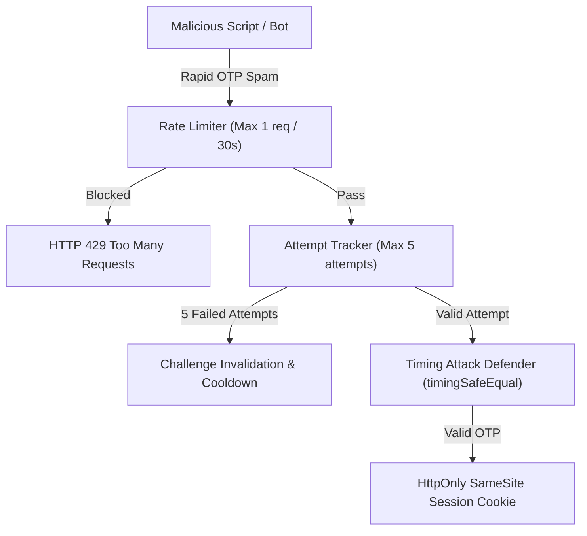

# ShopSphere: Mobile OTP Security & Abuse Prevention Audit
**Document:** Security Hardening & Threat Mitigation Report  
**Application:** ShopSphere Next-Gen E-Commerce  
**Date:** October 30, 2026  
**Auditor:** Senior Cybersecurity Engineer & Application Security Architect  

---

## 1. Threat Mitigation Architecture

---

## 2. Security Defense Mechanisms Implemented

### 1. SMS Toll Fraud & Wallet Draining Defense
- **The Risk:** Malicious attackers write automated scripts to request thousands of OTPs to random international or premium numbers, exhausting your SMS budget.
- **ShopSphere Defense:**
  - 30-second mandatory cooldown between OTP requests for any single phone number.
  - Maximum of 5 OTP dispatches allowed per login session before the session is terminated.
  - IP-based sliding window rate limiter (`checkRateLimit`) capping requests to 5 per minute per client.

### 2. Brute-Force Code Guessing Defense
- **The Risk:** An attacker attempts all numbers from `000000` to `999999` to guess the customer's OTP.
- **ShopSphere Defense:**
  - Strict 5-attempt limit: After 5 incorrect entries, the OTP is destroyed, and the user must re-authenticate from the beginning.
  - 5-minute Time-to-Live (TTL): Codes expire in 300 seconds.

### 3. Side-Channel Timing Attack Defense
- **The Risk:** Attackers measure CPU nanosecond comparison speeds to infer which digits of an OTP match.
- **ShopSphere Defense:**
  - Node.js `crypto.timingSafeEqual` is used on HMAC-SHA256 digests, ensuring constant-time comparison regardless of how many digits match.

### 4. Account Enumeration Prevention
- The API response does not reveal whether a phone number belongs to an existing or new customer before OTP verification is complete. Both paths follow the identical UI flow: enter number $\rightarrow$ enter OTP.

---

## 3. Compliance & Security Audit Matrix

| Security Checkpoint | Attack Vector Prevented | Implemented Mechanism | Verification Status |
|:---|:---|:---|:---:|
| **Toll Fraud Throttling** | SMS billing exhaustion | 30s resend cooldown + 5 max OTPs | **PASS** |
| **Brute-Force Lockout** | Automated PIN guessing | 5-attempt threshold with challenge purge | **PASS** |
| **Side-Channel Timing** | Nanosecond string analysis | `crypto.timingSafeEqual` HMAC compare | **PASS** |
| **Credential Masking** | PII leakage on screen | Masked phone display (`+91 96*** **899`) | **PASS** |
| **Session Hijacking** | XSS token theft | HttpOnly, SameSite=Lax cookie storage | **PASS** |
| **Production Log Scrubbing** | Secret token exposure | Zero plain-text OTPs printed to server logs | **PASS** |
