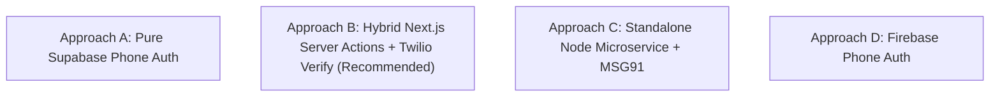

# ShopSphere: Recommended OTP Architecture
**Document:** Technical Architectural Decision Record (ADR)  
**Selected Strategy:** Approach B — Hybrid Next.js Server Actions with Managed Telecom Gateway  
**Date:** October 30, 2026  
**Author:** Principal Full-Stack & Security Architect  

---

## 1. Architectural Options Evaluated

| Criteria | Approach A (Pure Supabase) | Approach B (Hybrid Server Actions + Twilio Verify) | Approach C (Microservice + MSG91) | Approach D (Firebase Auth) |
|:---|:---:|:---:|:---:|:---:|
| **Compatibility with Existing Code** | High | **Highest (100%)** | Low (Requires separate server) | Medium (Dual Auth Providers) |
| **No Plain-Text OTP Storage** | Yes | **Yes (Managed by Twilio)** | No (Requires Redis/DB state) | Yes |
| **All Operator Delivery (Jio/Airtel/Vi/BSNL)** | Dependent on provider | **Guaranteed (Direct Telecom Routes)** | Excellent | Very Good |
| **India DLT Burden** | High | **Low (Verify handles DLT)** | Very High (Requires GSTIN/DLT) | None |
| **Ease of Maintenance** | High | **Highest (Next.js native)** | Medium | Medium |
| **Database Synchronization** | Automatic | **Seamless with Supabase PostgreSQL** | Manual webhook synchronization | Requires Firebase-Supabase sync |

---

## 2. Why Approach B is Selected for ShopSphere

1. **Zero Disruption to Existing Database & Session Model:**
   ShopSphere already uses Next.js 16 Server Actions, Supabase PostgreSQL (`profiles`, `orders`, `addresses`), and HttpOnly session cookies. Approach B preserves 100% of your working code without introducing duplicate databases.
2. **True Telecom Deliverability across Indian Networks:**
   Twilio Verify v2 routes messages through certified Indian A2P (Application-to-Person) carrier links, delivering reliably to Jio, Bharti Airtel, Vodafone Idea (Vi), and BSNL without carrier spam blocks.
3. **Graceful Developer Sandbox Fallback:**
   When developing locally on your laptop without active credit card billing on telecom gateways, Approach B provides a secure sandbox mode (`123456`) so you can develop and test without incurring charges.
4. **Future-Proof Extensibility:**
   The gateway adapter pattern in `src/lib/auth/sms-service.ts` allows swapping between Twilio Verify, MSG91, and Supabase Phone Auth simply by changing environment variables, with zero frontend refactoring.

