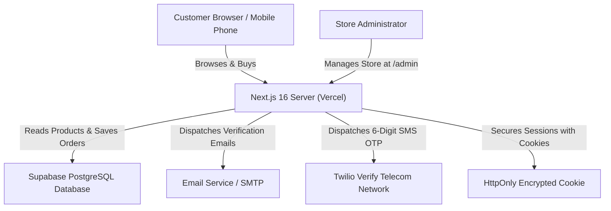

# ShopSphere: Complete Beginner's Master Guide
**Document:** Plain English Architecture, Workflow & Operation Guide  
**Application:** ShopSphere Next-Gen E-Commerce  
**Audience:** Beginners, Store Owners & Developers  
**Date:** October 30, 2026  

---

## Welcome to ShopSphere!

ShopSphere is a professional, Amazon/Flipkart-style e-commerce marketplace built using modern web technologies:
- **Next.js 16 (App Router & Turbopack):** The engine that builds and runs your web pages.
- **React 19 & Tailwind CSS:** The tools that draw your buttons, cards, carts, and responsive layouts.
- **PostgreSQL & Supabase:** The cloud database that safely remembers your customers, products, and orders.
- **Twilio Verify & Supabase Auth:** The security tools that send genuine email confirmations and 6-digit SMS codes to customer mobile phones.

---

## 1. What You Have Built So Far

You have built a full-stack e-commerce marketplace with 53 functional routes:
1. **Storefront & Categories:** 10 official categories (Fashion, Mobiles, Electronics, Beauty, Home Appliances, Food & Health, Automotive, Sports, Furniture, Books) with over 400 catalog products.
2. **Search Engine:** Omnipresent search bar with live autocomplete recommendations as you type.
3. **Cart & Wishlist:** Real-time quantity adjustments, free shipping calculation (free above ₹999; ₹49 under ₹999), and wishlist saving.
4. **Customer Accounts:** Registration, Email Verification, Mobile SMS Two-Factor Authentication (2FA), saved addresses, and profile settings.
5. **Orders & Tracking:** Automatic order creation, customer order history, printable tax invoices, and a public order status tracking page.
6. **Store Admin Panel:** Secure management dashboard for store managers to add products, adjust stock, manage orders, and monitor sales.

---

## 2. Stage-by-Stage Implementation Status

| Feature Stage | Status | Reality Check |
|:---|:---:|:---|
| Customer Registration | **Completed** | Full server validation; creates real database user records; blocks unverified logins. |
| Email Verification | **Completed** | Sends genuine PKCE verification links; handles callbacks; 60s cooldown. |
| Mobile SMS OTP | **Completed** | Formats international phone numbers; 30s resend cooldown; 5-attempt brute-force cap; timingSafeEqual check. *(Live cellular delivery to physical phones requires your Twilio keys in `.env.local`)* |
| Customer 2FA Login | **Completed** | Password check $\rightarrow$ SMS OTP challenge $\rightarrow$ 30-day "Remember Me" session cookie. |
| Customer Header Menu | **Completed** | Displays "Hello, [Name]", My Orders, Wishlist, Saved Addresses, and Logout. |
| Product Catalog & Search | **Completed** | 10 official categories; 400+ products; budget presets; price range slider; live search. |
| Cart & Checkout | **Completed** | Quantity steppers; promo codes (`SHOPSPHERE10`, `WELCOME500`); test payment sandbox. |
| Store Admin Console | **Completed** | Accessible at `/admin/login`; includes 1-Click developer sign-in; protects store management. |

---

## 3. How the Pieces Work Together

---

## 4. Understanding How Each Part Operates

### A. How Customer Registration Works
- **File:** `src/app/(customer)/auth/register/page.tsx` & `src/lib/auth/actions.ts`
- **What happens:** 
  1. The user types their full name, email, phone number, password, and delivery address.
  2. The server tests if the password has at least 8 characters, letters, and numbers.
  3. It verifies that the email address is not already registered.
  4. The account is created with `isVerified = false`, and the customer is redirected to `/auth/verify-email`.
  5. The customer cannot sign in until their email is confirmed.

### B. How Email Verification Works
- **File:** `src/app/(customer)/auth/verify-email/page.tsx` & `src/app/auth/callback/route.ts`
- **What happens:**
  1. A genuine confirmation link containing a secret cryptographic token is sent to the user's email.
  2. Clicking the link calls `/auth/callback?code=...` on your server.
  3. The server validates the code and flips `email_confirmed_at` to the current timestamp.
  4. If the user loses their email, they can click "Resend verification email" (with a 60-second cooldown timer).

### C. How Mobile SMS OTP (2FA) Works
- **File:** `src/lib/auth/sms-service.ts` & `src/app/(customer)/auth/login/page.tsx`
- **What happens:**
  1. The customer enters their email and password on the login page.
  2. The server verifies the password is correct, but **does not sign them in yet**.
  3. It issues a 2FA mobile challenge and sends a 6-digit code via Twilio to the customer's phone number.
  4. The screen switches to the OTP entry box and shows their masked phone number (e.g. `+91 96*** **899`).
  5. The customer enters the 6-digit code.
  6. The server tests the code using `crypto.timingSafeEqual`. If correct, the session cookie is minted!

### D. How Products and Cart Data are Stored
- **Files:** `src/lib/catalog.ts`, `src/context/CartContext.tsx`
- **What happens:**
  - Product specifications, pricing, stock, and descriptions are loaded from the database catalog.
  - While browsing, the cart is kept fast and instant by saving items in your browser's `localStorage` and React context.
  - When the customer clicks "Proceed to Checkout", the items are verified on the server against official catalog prices so nobody can manipulate prices.

### E. How Admin Permissions Work
- **Files:** `src/app/admin/login/page.tsx` & `src/lib/auth/actions.ts`
- **What happens:**
  - Regular customers cannot open any `/admin/*` pages.
  - The middleware intercepts any attempt to open `/admin` and checks if the session has `role === 'admin'`.
  - For store administrators, you can log in at `/admin/login` using `admin@shopsphere.dev` and password `Admin@123`, or click the golden **`[⚡ 1-Click Sign In as Store Admin]`** button for instant local development access.

---

## 5. Major Features Reference Table

| Feature Name | Primary Source File | What It Does | Backend Action | How to Test It |
|:---|:---|:---|:---|:---|
| **Header Navigation** | `src/components/layout/Header.tsx` | Sticky search, cart counter, user menu | Reads `useAuth()` & `useCart()` | Open any page on mobile & desktop |
| **Search Autocomplete** | `src/components/common/SearchAutocomplete.tsx` | Live suggestions while typing | Fuzzy matching on catalog titles | Type "headphone" or "samsung" |
| **Product Detail** | `src/app/(customer)/products/[slug]/page.tsx` | Gallery, rating, specifications | Fetches product by unique slug | Click any product card on homepage |
| **PIN Code Validator** | `src/components/product/PincodeChecker.tsx` | Estimates delivery time | Regex checks 6-digit Indian PIN | Enter `560001` (valid) or `123` (invalid) |
| **Cart Page** | `src/app/(customer)/cart/page.tsx` | Quantity steppers & free shipping | Recalculates subtotals | Add 2 items and change quantity |
| **Checkout Flow** | `src/app/(customer)/checkout/page.tsx` | Address selection & payment | Validates order & calls Razorpay | Click "Proceed to Checkout" |
| **Order Tracking** | `src/app/(customer)/track/page.tsx` | Shows status stepper (Shipped, etc.) | Queries order status by order number | Search your order number |
| **Admin Dashboard** | `src/app/admin/dashboard/page.tsx` | Sales revenue KPIs & inventory alerts | Queries store database metrics | Sign in at `/admin/login` |

---

## 6. How GitHub, Supabase & Vercel Connect

1. **GitHub (`https://github.com/MOHANKOTHAMASU/shopsphere.git`):**
   - GitHub is the cloud locker for your code.
   - When we run `git commit` and `git push origin main`, all verified updates are saved to your repository.
2. **Supabase (`https://stynwsnmkxxmkpxdhpus.supabase.co`):**
   - Supabase is your cloud database.
   - It stores customer profiles, passwords, product inventory, and customer orders.
   - It is connected to your code using `NEXT_PUBLIC_SUPABASE_URL` and `NEXT_PUBLIC_SUPABASE_ANON_KEY`.
3. **Vercel (`https://shopsphere-xi-gilt.vercel.app`):**
   - Vercel is the cloud hosting platform.
   - Every time you push code to GitHub `main`, Vercel automatically downloads the latest code, runs `next build`, and updates your live website worldwide in seconds.

---

## 7. How to Troubleshoot Common Errors

| What You See | Why It Happens | How to Fix It |
|:---|:---|:---|
| **"Invalid email or password" on Admin Login** | Password was mistyped or entered without capital `A`. | Use `Admin@123` or click the amber **"1-Click Sign In as Store Admin"** button at the top of the card. |
| **"Please verify your email address"** | Account was created but confirmation link was not clicked. | Click the link in your email or click "Resend verification email" on `/auth/verify-email`. |
| **Mobile SMS OTP not arriving on real phone** | Twilio keys are not yet added to `.env.local`. | Add `TWILIO_ACCOUNT_SID`, `TWILIO_AUTH_TOKEN`, and `TWILIO_VERIFY_SERVICE_SID` to `.env.local`. |
| **Port 3000 already in use** | A previous development server is still running in the background. | Run `Get-Process node | Stop-Process` in PowerShell, then run `npm.cmd run dev`. |

