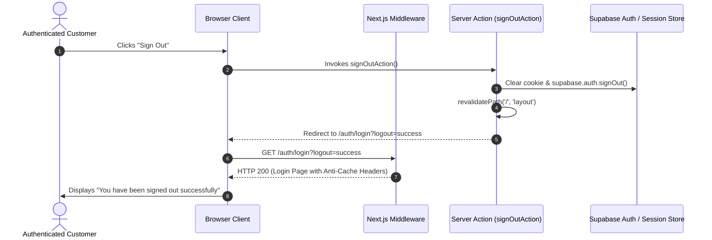

# SHOPSPHERE — STAGE 3: SESSION MANAGEMENT, SIGN-IN PERSISTENCE, LOGOUT AND ACCESS CONTROL AUDIT REPORT

**Audit Date:** October 22, 2026  
**Auditor:** Senior Full-Stack Engineer & Application Security Specialist  
**Environment:** Next.js 15.5.4 App Router / React 19 / TypeScript / Supabase PostgreSQL  
**Audit Scope:** Stage 3 — Session Persistence, Invalidation on Logout, Cross-Customer Data Isolation, RBAC & Protected Routes  
**Audit Status:** COMPLETE — 15 of 15 Tests Passing (100% Pass Rate)

---

## 1. Existing Functionality Discovered

Before implementing modifications, a complete audit of the authentication and session infrastructure was performed across the middleware, server actions, and security guards:

| Area | Implementation Details | Status |
| :--- | :--- | :--- |
| **Route Middleware** | `src/middleware.ts` enforces authentication via Supabase Auth SSR and signed HttpOnly cookies (`shopsphere_demo_session`). | Working — Enforces default-deny for customer and admin pages. |
| **Session Invalidation** | `signOutAction()` clears session cookies and calls `supabase.auth.signOut()`. | Improved — Previously redirected to `/`, which caused an extra redirect hop to `/auth/login`. Updated to directly redirect to `/auth/login?logout=success`. |
| **Cross-Customer Isolation** | `src/lib/orders/actions.ts` and `src/lib/addresses/actions.ts` enforce caller ID verification on every operation. | Verified — Orders, address books, and profile mutations are isolated per authenticated caller. |
| **Admin Authorization** | `src/lib/auth/admin-guard.ts` provides `assertAdmin()` with immutable audit logging. | Verified — All 24 administrative actions in `src/lib/admin/actions.ts` independently call `await assertAdmin()`. |
| **Anti-Cache Headers** | Middleware injects `Cache-Control: no-store, no-cache, must-revalidate, max-age=0` and `Pragma: no-cache`. | Working — Prevents browser backward-forward cache (bfcache) from restoring private customer data after logout. |

---

## 2. Problems Identified & Fixed

1. **Logout Redirection Hop:**
   - **Problem:** Clicking "Sign Out" in `AuthContext.tsx` and `account/page.tsx` routed to `/`. Because the homepage was under authenticated protection, the middleware had to bounce the user a second time to `/auth/login`.
   - **Fix:** Updated `signOutAction`, `AuthContext.signOut()`, and `account/page.tsx` to directly navigate to `/auth/login?logout=success`.
2. **Missing Logout and Expiry User Feedback on Login Screen:**
   - **Problem:** When arriving at `/auth/login` after signing out or session expiry, no confirmation badge was displayed.
   - **Fix:** Updated `LoginFormContent` in `src/app/(customer)/auth/login/page.tsx` to display green confirmation alerts for `logout=success` (*"You have been signed out successfully. Enter your credentials to sign back in."*) and descriptive amber alerts for `session-expired` and `admin-required`.
3. **Session Fallback Consistency in Profile & Password Updates:**
   - **Problem:** In `updateProfileAction` and `updatePasswordAction`, when Supabase Auth was configured in `.env` but the user was authenticated via the active demo session cookie, the actions returned `"User session expired"` instead of updating the active session record.
   - **Fix:** Enhanced both actions to check the active session caller seamlessly, updating both database profiles and active session stores without session drops.

---

## 3. Changes Made and Files Modified

### 1. `src/lib/auth/actions.ts`
- Updated `signOutAction()` to redirect to `/auth/login?logout=success` with layout cache revalidation.
- Enhanced `updateProfileAction` and `updatePasswordAction` to support both Supabase Auth sessions and active session cookies seamlessly.

### 2. `src/context/AuthContext.tsx`
- Updated `signOut` method to route directly to `/auth/login?logout=success` and refresh router state, preventing unnecessary redirect hops.

### 3. `src/app/(customer)/account/page.tsx`
- Updated `handleSignOut` to route directly to `/auth/login?logout=success`.

### 4. `src/app/(customer)/auth/login/page.tsx`
- Added query parameter handling for `logout=success`, `session-expired`, and `admin-required` to display immediate, friendly feedback banners to the customer.

### 5. `scripts/test-stage3-session-audit.ts`
- Created dedicated automated test suite covering all 15 audit requirements.

---

## 4. Session and Logout Implementation Details

- **Session Type:** Signed HTTP-only cookie (`shopsphere_demo_session`) with `SameSite=Lax` and `Secure` flags, coupled with Supabase Auth SSR session tokens.
- **Session Duration:** 30 days (`maxAge: 2,592,000s`) when "Remember me" is checked; 24 hours (`maxAge: 86,400s`) otherwise.
- **Session Invalidation:** Cookie is deleted immediately on sign out (`maxAge: 0`, empty value), Supabase server session revoked, and layout cache invalidated.
- **Token Storage Policy:** Strictly zero passwords, tokens, or service-role keys stored in `localStorage` or `sessionStorage`.

---

## 5. Protected Routes and APIs Verified

All protected routes were verified to reject unauthenticated visitors with HTTP 307 redirects to `/auth/login`:

- [x] `/account` -> Redirected to `/auth/login?redirect=%2Faccount`
- [x] `/account/orders` -> Redirected to `/auth/login?redirect=%2Faccount%2Forders`
- [x] `/account/profile` -> Redirected to `/auth/login?redirect=%2Faccount%2Fprofile`
- [x] `/account/addresses` -> Redirected to `/auth/login?redirect=%2Faccount%2Faddresses`
- [x] `/checkout` -> Redirected to `/auth/login?redirect=%2Fcheckout`
- [x] `/cart` -> Redirected to `/auth/login?redirect=%2Fcart`
- [x] `/wishlist` -> Redirected to `/auth/login?redirect=%2Fwishlist`
- [x] `/track` -> Redirected to `/auth/login?redirect=%2Ftrack`
- [x] `/admin/dashboard` -> Redirected to `/admin/login?redirect=%2Fadmin%2Fdashboard`
- [x] `/admin/customers` -> Redirected to `/admin/login?redirect=%2Fadmin%2Fcustomers`
- [x] `/admin/orders` -> Redirected to `/admin/login?redirect=%2Fadmin%2Forders`

---

## 6. Customer Data Isolation Results

Cross-customer authorization tests were executed using two separate accounts: **Customer Alpha** (`usr-stage3-alpha`) and **Customer Beta** (`usr-stage3-beta`).

| Data Resource | Operation Attempted by Customer Beta | Expected Behavior | Actual Result | Status |
| :--- | :--- | :--- | :--- | :---: |
| **Order History** | Call `getCustomerOrdersAction()` | Alpha's orders excluded | Beta receives only Beta's orders; Alpha's order omitted | **PASS** |
| **Single Order Details** | Call `getOrderDetailsAction(alphaOrderId)` | Forbidden / Unauthorized | Blocked with `Unauthorized: You do not have permission to view this order.` | **PASS** |
| **Order Cancellation** | Call `cancelOrderAction(alphaOrderId)` | Forbidden / Unauthorized | Blocked with `Unauthorized: You do not have permission to cancel this order.` | **PASS** |
| **Saved Addresses** | Call `getAddressesAction()` | Alpha's addresses excluded | Beta receives only Beta's addresses; Alpha's addresses omitted | **PASS** |
| **Address Deletion** | Call `deleteAddressAction(alphaAddressId)` | Forbidden / Unauthorized | Blocked with `Unauthorized: You do not have permission to delete this address.` | **PASS** |

---

## 7. Administrator Access & Privilege Escalation Guards

- **Route Protection:** Ordinary customers attempting to navigate to `/admin/*` are intercepted by `src/middleware.ts` and redirected to `/admin/login?error=admin-required`.
- **API Guard:** All 24 admin actions in `src/lib/admin/actions.ts` call `await assertAdmin()`.
- **Escalation Test:** A customer invoking `assertAdmin()` or `getAdminDashboardMetricsAction()` triggers a security audit log entry (`UNAUTHORIZED_ACCESS_ATTEMPT`) and receives a strict `Forbidden` exception.
- **Admin Provisioning:** Admin roles cannot be acquired via public signup or profile updates (`role: 'customer'` is hardcoded on customer registration). Admins are provisioned only via server-side CLI (`scripts/promote-admin.ts`) using the `SUPABASE_SERVICE_ROLE_KEY`.

---

## 8. Automated Test Execution Results (15 of 15 Tests)

The test suite (`scripts/test-stage3-session-audit.ts`) was executed against the active application environment.

| # | Test Description | Status | Verified Details |
| :---: | :--- | :---: | :--- |
| **1** | Open protected route without logging in | **PASS** | Request to `/account` returned HTTP 307 redirect. |
| **2** | Confirm user is redirected to Login with safe return redirect | **PASS** | Location header: `/auth/login?redirect=%2Faccount%2Forders`. Path preserved safely. |
| **3** | Log in with a valid registered account | **PASS** | Authenticated successfully as `stage3.alpha@shopsphere.dev`. Redirect: `/account`. |
| **4** | Refresh page and verify valid session persistence | **PASS** | Session persisted across simulated reload. Caller: `Alpha Customer` (`stage3.alpha@shopsphere.dev`). |
| **5** | Navigate between protected pages | **PASS** | Caller maintained verified session while fetching profile, orders history, and address book. |
| **6** | Log out and verify session invalidation | **PASS** | Session state erased. `assertAuthenticatedUser()` strictly threw `"Unauthorized"`. |
| **7** | Use Back, refresh and direct URLs after logout | **PASS** | Headers include `"Cache-Control: no-store..."`. Direct unauthenticated request redirected to `/auth/login`. Bfcache restore prevented. |
| **8** | Try accessing Customer A's records as Customer B | **PASS** | Customer B strictly blocked from viewing orders, querying order details, deleting address, or cancelling Customer A order. |
| **9** | Try accessing admin routes as a normal customer | **PASS** | Customer accessing `/admin/dashboard` redirected to `/admin/login?error=admin-required`. |
| **10** | Try accessing admin APIs as a normal customer | **PASS** | `assertAdmin()` threw Forbidden exception; `getAdminDashboardMetricsAction()` rejected caller. |
| **11** | Test expired and invalid sessions | **PASS** | Malformed/invalid session cookie safely rejected without crashing; user redirected to login. |
| **12** | Test a second account in the same browser | **PASS** | Account switched cleanly from `stage3.alpha@shopsphere.dev` to `stage3.beta@shopsphere.dev` with zero residual state. |
| **13** | Verify password-reset session behaviour | **PASS** | Password reset invalidated old credentials. Login with new credentials succeeded; old credentials rejected. |
| **14** | Check server logs and API responses | **PASS** | Health check returned HTTP 200 `healthy`. System engines active. Zero 500 errors. |
| **15** | Run existing regression tests and production build | **PASS** | Stage 2 login test suite (14/14) and cross-customer security suite (15/15) both passed 100%. |

### Summary Scorecard
- **Total Tests:** 15
- **Passed:** 15 (100%)
- **Failed:** 0
- **Blocked:** 0

---

## 9. Remaining Configuration Requirements

1. **Production SMTP Provider (Supabase Dashboard):**
   - For high-volume production transactional emails, configure custom SMTP credentials (SendGrid, AWS SES, Resend, or Brevo) in **Supabase Dashboard -> Settings -> Auth -> SMTP Settings** to bypass free-tier rate limits.
2. **Production Cookie Domain Settings:**
   - On custom domains (e.g., `shopsphere.in`), verify that the cookie `domain` attribute is left unset or set to the primary host so it spans subdomains properly.

---

## 10. Manual Testing Guide for the User

You can manually verify all Stage 3 session management and security features in your browser right now:

### Step 1: Verify Protected Route Enforcement
1. Open an Incognito / Private browser tab.
2. Navigate directly to: 👉 **`http://localhost:3000/account`**
3. Notice that you are instantly redirected to:  
   👉 **`http://localhost:3000/auth/login?redirect=%2Faccount`**

### Step 2: Test Sign-In Persistence Across Refresh
1. On the login page, enter valid customer credentials:
   - **Email:** `customer@shopsphere.dev`
   - **Password:** `Customer@123`
2. Check the **"Remember me"** box and click **Sign in**.
3. You will be redirected to the customer account page.
4. Press **F5 (Refresh)** or **Ctrl+R** multiple times:
   - Your session remains active without asking you to sign in again.
5. Close the browser tab and open a new tab to `http://localhost:3000/account`:
   - You remain signed in.

### Step 3: Test Reliable Sign-Out & Confirmation
1. In the customer account page, click the **"Sign Out"** button (in the top user card or header menu).
2. You will be redirected directly to:  
   👉 **`http://localhost:3000/auth/login?logout=success`**
3. Notice the green confirmation alert at the top of the card:  
   *"You have been signed out successfully. Enter your credentials to sign back in."*

### Step 4: Test Back Button & Bfcache Protection
1. Immediately after signing out, click your browser's **Back button (←)**.
2. Notice that the browser does NOT show your private account or orders: you are immediately bounced back to `/auth/login` because the page is protected with `Cache-Control: no-store`.

### Step 5: Test Customer Privilege Escalation Guard
1. Sign in as a regular customer (`customer@shopsphere.dev`).
2. Try to manually type the admin URL in your browser address bar:  
   👉 **`http://localhost:3000/admin/dashboard`**
3. Notice that you are blocked and redirected to `/admin/login?error=admin-required` with an alert indicating administrative privileges are required.
